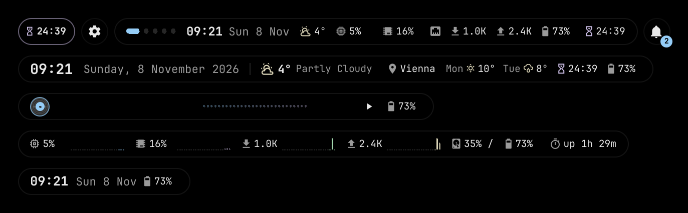
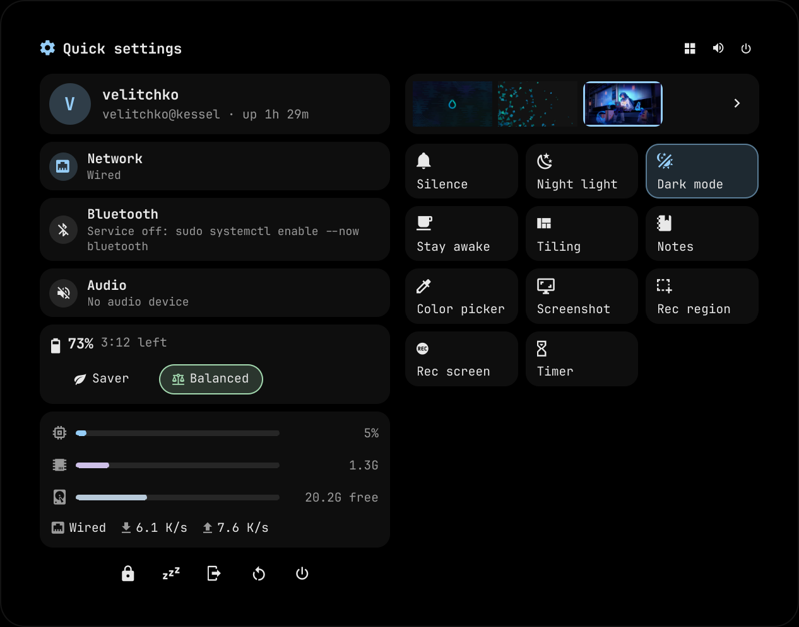
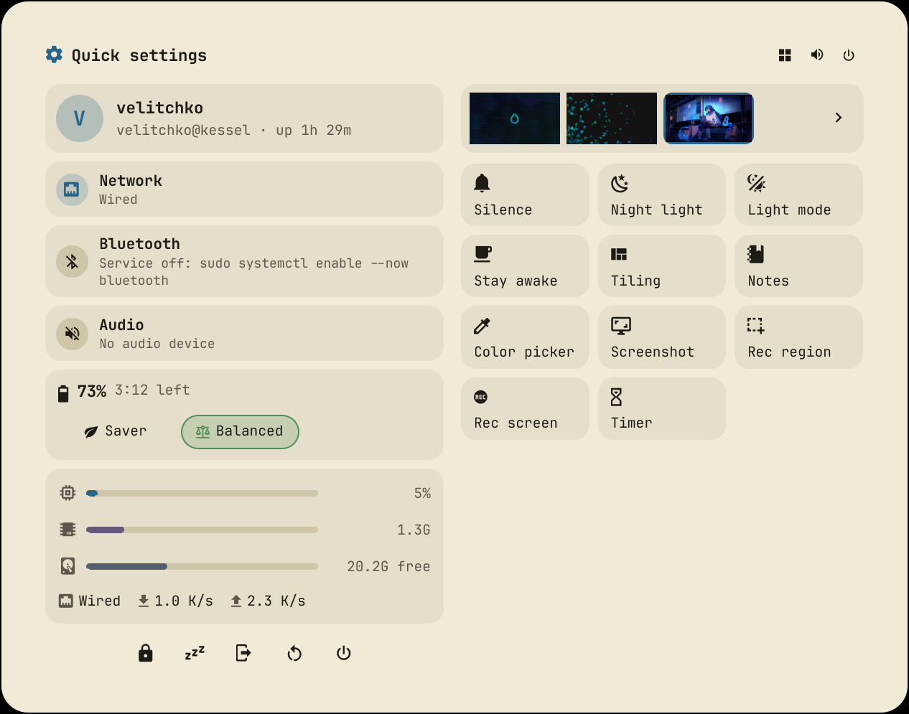
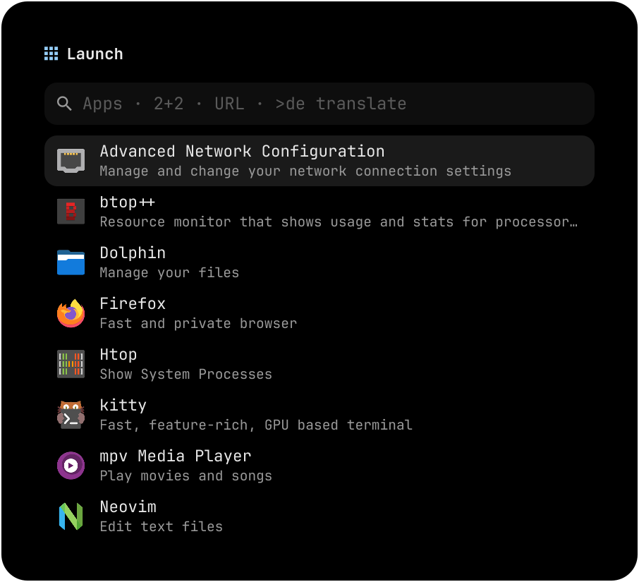
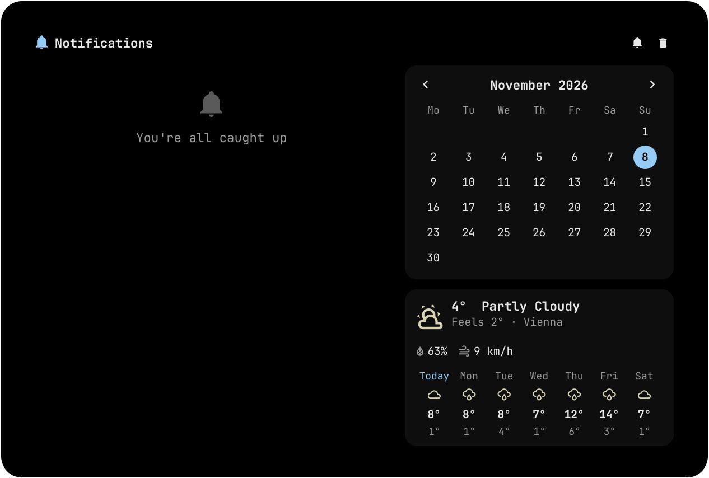
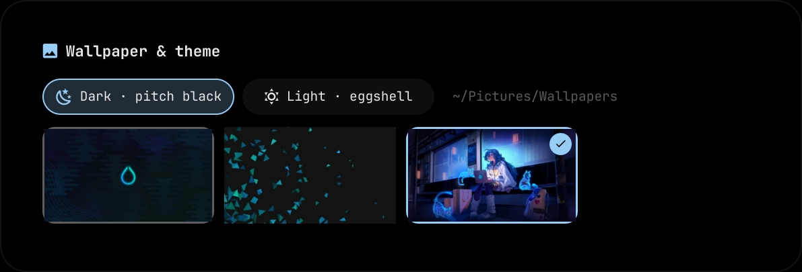
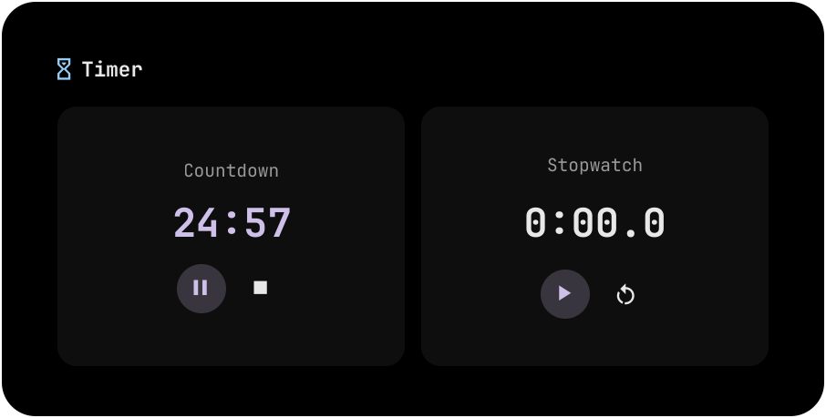
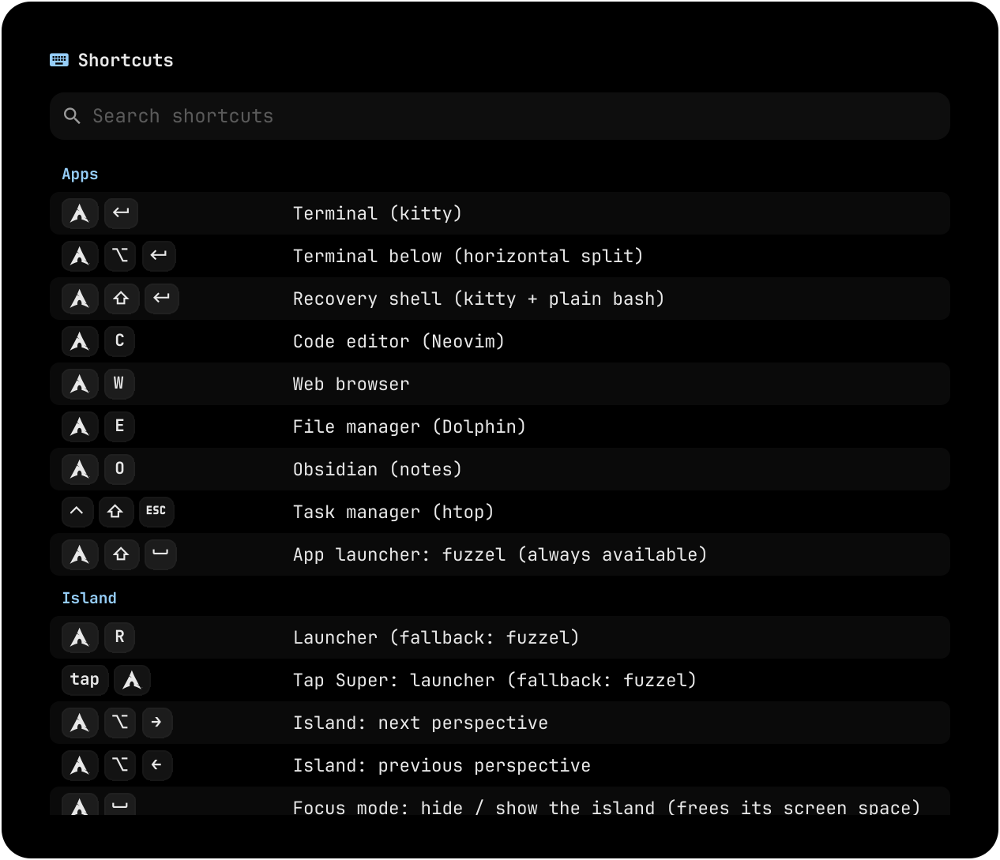
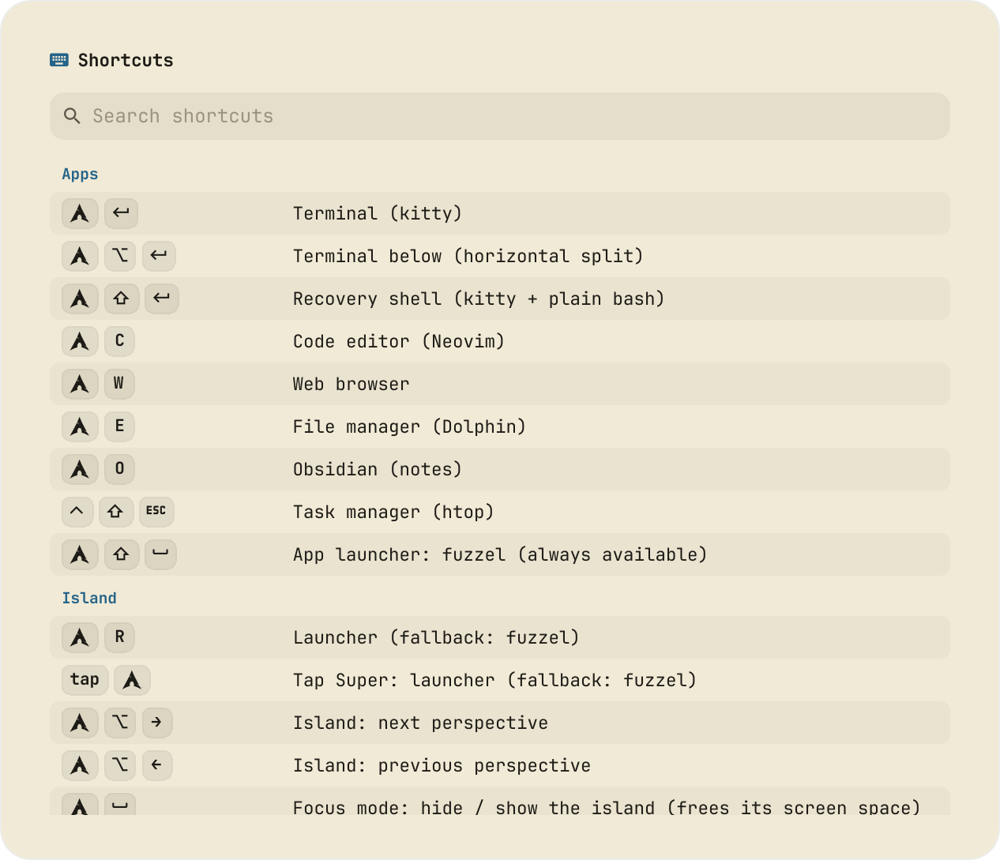

# dots


-58E1FF?logo=hyprland&logoColor=white)


My Arch Linux desktop: **Hyprland** (Lua config), **Quickshell**, and a dynamic island instead of a bar. Accents come from the wallpaper; the base is pitch black (dark) or eggshell (light).

> **Personal dotfiles, use at your own risk.** Tuned to my hardware and habits, no support. Read the scripts, start with `--dry-run`, keep a backup.



| Quick settings | Light mode |
| --- | --- |
|  |  |
| **Launcher** (apps, calculator, URLs, translation) | **Notifications** (calendar, weather) |
|  |  |
| **Wallpaper & theme** | **Timer** |
|  |  |
| **Shortcuts** (`SUPER+/`) | **Shortcuts** in light mode |
|  |  |

<sub>Screenshots are the real island components rendered offscreen on a VM (no Wi-Fi or audio hardware there; the battery is simulated).</sub>

## What's in it

- **Island** (Quickshell): workspaces, time, weather, media, system stats, battery. Scroll over it to switch view (Overview · Time · Music · Metrics · Minimal). It morphs into panels: quick settings, notifications, launcher, clipboard, workspace overview, notes, media, mixer, timer, wallpaper, shortcuts. Small pills beside it show a running countdown, mic/camera/screen use (click to mute the mic) and pending updates.
- **Terminal:** kitty + fish + Starship. **Editor:** Neovim (LazyVim).
- **Launchers:** island launcher (`SUPER+R` or tap `SUPER`) and fuzzel (`SUPER+SHIFT+Space`) as fallback.
- **Theme:** one script recolors everything from the wallpaper (island, Hyprland, kitty, fish, GTK, Qt/KDE, Neovim, lock, login).
- **Lock + login:** Quickshell lock screen and a matching SDDM theme.
- **Safe:** configs are symlinks into this repo, every deployment can be rolled back, and the desktop still works if Quickshell is down.

## Install

Fresh Arch with Hyprland and SDDM. The first command is a dry run.

```sh
sudo pacman -S --needed git
git clone https://github.com/velitchko/dots ~/dot-files && cd ~/dot-files

./install.sh --dry-run --with-aur --apply-config   # 1. preview (changes nothing)
./install.sh --with-aur --apply-config             # 2. packages + config links + theme
./install.sh --set-shell                           # 3. optional: fish as login shell
~/Scripts/sddm-theme.sh install                    # 4. optional: login screen (sudo)
~/Scripts/root-prompt.sh install                   #    optional: themed prompt for root shells too (sudo)
./install.sh --check                               # 5. verify
```

Log out and back in once. Then see **Laptop** and **Translation** below if you want them.

| Flag | What it does |
| --- | --- |
| `--apply-config` | Link configs into `~` (anything replaced is backed up) and generate the theme |
| `--with-aur` | AUR extras via yay (installs yay if needed): OmniGlyph emoji picker, Bibata cursor, hyprmoncfg display manager |
| `--with-laptop` | Bluetooth, power profiles, laptop audio firmware (see **Laptop**) |
| `--with-translate` | Offline translation (see **Translation**) |
| `--with-tex` | Full TeX Live for LaTeX in Neovim (~2.8 GB) |
| `--set-shell` | Make fish the login shell |
| `--skip-packages` | Only config / extras, no package install |
| `--rollback [ts]` | Undo a config deployment |
| `--dry-run` | Show what would happen |

The installer never enables services, never touches SSH, network or firewall, and never handles secrets.

## Laptop

```sh
./install.sh --with-laptop                            # bluez, power-profiles-daemon, fprintd, sof-firmware, alsa-ucm-conf
sudo systemctl enable --now bluetooth                 # the installer never enables services
sudo systemctl enable --now power-profiles-daemon     # Saver / Balanced / Performance in quick settings
systemctl --user restart wireplumber                  # once, so Bluetooth audio devices show up
```

- **Quick settings** (`SUPER+A`) then shows Wi-Fi, Bluetooth, battery and power modes. Each row says what's missing (e.g. "Service off: …") instead of disappearing.
- **Wi-Fi:** click the row to see networks. Open networks connect directly, others ask for a password. Hover a saved network to forget it. "Hidden network, VPN, more…" opens NetworkManager's editor.
- **Bluetooth:** "Nearby" devices pair with one click, then connect. Pairing runs through `~/.config/hypr/scripts/bt-pair.sh` (BlueZ needs a pairing agent). Devices that need a typed PIN (some keyboards) still need `bluetoothctl`.
- **Audio:** expand the output / microphone row to switch devices (Bluetooth headsets appear here once connected).
- **Fingerprint reader:** see below.
- **No sound devices at all?** Most laptops since ~2018 need `sof-firmware` (included in `--with-laptop`). Reboot after installing.
- **Beeping in terminals / TTYs?** That's the PC speaker. Turn it off with:
  ```sh
  printf 'blacklist pcspkr\nblacklist snd_pcsp\n' | sudo tee /etc/modprobe.d/nobeep.conf
  ```
- **Displays:** `monitors.lua` arranges them automatically and re-applies on hot-plug: one external display goes to the **left** of the laptop; with three, the main one sits in the middle (set `MAIN_MONITOR`).
- **Display manager (optional):** [hyprmoncfg](https://github.com/crmne/hyprmoncfg) (installed with `--with-aur`) lets you drag displays into place and save profiles like `desk` or `home`. Run `hyprmoncfg`; once you apply a layout it takes over from `monitors.lua`. To switch profiles automatically on plug/unplug and lid close: `systemctl --user enable --now hyprmoncfgd`. Delete `~/.config/hypr/hyprmoncfg-monitors.lua` to go back to the automatic layout.

### Fingerprint

`fprintd` comes with `--with-laptop` (it starts on demand, no service to enable).

```sh
~/Scripts/fingerprint.sh enroll        # touch the sensor until it says done (default: right index finger)
~/Scripts/fingerprint.sh status        # reader, enrolled fingers, login-screen state
```

- **Lock screen:** works right after enrolling. The field says *Password or fingerprint*; touch the sensor or type, whichever comes first. Nothing in `/etc` changes (the lock brings its own fingerprint PAM stack).
- **Login screen (optional):** `~/Scripts/fingerprint.sh sddm-on`, then `~/Scripts/sddm-theme.sh install`. At login, press **Enter on an empty password**, then touch the sensor; a typed password still works. It edits `/etc/pam.d/sddm` (shows the diff, asks, keeps a backup); `sddm-off` undoes it.
- A fingerprint login can't unlock a keyring (GNOME Keyring / KWallet need the password).

Details: [`docs/DESKTOP.md`](docs/DESKTOP.md#fingerprint).

## Translation (offline)

Runs fully on your machine (Bergamot, the engine behind Firefox's translation). Needs a CPU with **AVX2** (any recent laptop; on a VM set the CPU type to `host`).

```sh
./install.sh --skip-packages --with-translate          # runtime + EN↔DE, EN↔BG (~150 MB)
~/.config/hypr/scripts/translate.sh status             # should print: ready
~/.config/hypr/scripts/translate.sh installed          # en-de, de-en, en-bg, bg-en
```

In the launcher (`SUPER+R`):

| Type | Translates |
| --- | --- |
| `>de good morning` | English → German |
| `>bg good morning` | English → Bulgarian |
| `>en Guten Morgen` | German → English (Latin text is assumed German) |
| `>en Добро утро` | Bulgarian → English (Cyrillic is detected) |
| `>de-bg Hallo` | any pair (goes through English) |

Enter copies the result. More languages: `translate.sh available`, then e.g. `translate.sh add en-fr`. If translating errors out, run `translate.sh repair` (fixes half-installed models) or `translate.sh add de-en` for a missing direction.

## Daily use

| Keys | Action |
| --- | --- |
| `SUPER + Return` · `SUPER + ALT + Return` | Terminal (kitty) · terminal below the current window |
| `SUPER + ALT + J` | Flip a split (side by side ↔ stacked) |
| tap `SUPER` · `SUPER + R` | Launcher |
| `SUPER + A` / `SUPER + ALT + N` | Quick settings / notifications |
| `SUPER + Tab` | Workspace overview (click to focus, drag to move) |
| `SUPER + V` · `SUPER + .` | Clipboard history · emoji picker |
| `SUPER + G` / `SUPER + SHIFT + G` | Notes (`~/Notes`) / kanban board |
| `SUPER + M` / `SUPER + SHIFT + V` | Media player / volume mixer |
| `SUPER + ALT + T` | Timer + stopwatch (a pill shows the countdown beside the island) |
| `CTRL + SUPER + T` / `CTRL + SUPER + SHIFT + D` | Wallpaper picker / toggle light-dark |
| `SUPER + SHIFT + S` · `Print` | Screenshot region · screen (→ `~/Pictures/Screenshots` + clipboard) |
| `SUPER + SHIFT + R` · `CTRL + ALT + R` | Record region · screen; same keys stop (→ `~/Videos/Recordings`) |
| `SUPER + SHIFT + C` | Color picker |
| `SUPER + E` · `SUPER + C` · `SUPER + W` · `SUPER + O` | Files · Neovim · browser · Obsidian |
| `SUPER + Q` · `SUPER + F` · `SUPER + D` | Close · fullscreen · float/tile window |
| `SUPER + 1…0` / `SUPER + ALT + 1…0` | Go to / send window to workspace |
| `SUPER + S` | Scratchpad |
| `SUPER + Space` | Focus mode (hide the island) |
| `SUPER + L` / `SUPER + SHIFT + L` | Lock / suspend |
| `CTRL + ALT + Delete` | Session menu |
| `CTRL + SUPER + R` | Reload Hyprland + restart the island |
| `SUPER + /` | All shortcuts (searchable panel; fuzzel if the island is down) |

### Pills beside the island

| Pill | Shows | Click |
| --- | --- | --- |
| Countdown (left of ⚙) | time left of a running countdown; a pause icon while paused | opens the timer |
| Privacy (red, right of 🔔) | mic, camera or screen in use; hover for which apps | **mic:** mute / unmute (grey crossed-out mic while muted; a red halo pulses while you talk). **camera:** jumps to the app using it (a webcam can't be muted, turn it off there) |
| Updates | number of pending package updates | runs the update in a terminal |

Full list: [`docs/SHORTCUTS.md`](docs/SHORTCUTS.md) (generated from `.config/hypr/keybinds.lua`, the single source of truth).

**Wallpapers:** drop images into `~/Pictures/Wallpapers`, pick one from quick settings or `CTRL+SUPER+T`. Accents follow the wallpaper; details in [`docs/THEME.md`](docs/THEME.md).

**Profile picture:** `~/.face` (shown round in the island, lock and login screen).

## Update

```sh
~/Scripts/update.sh            # pull, re-apply config, reload Hyprland, restart the island
~/Scripts/update.sh --system   # …and pacman -Syu  (--aur also updates AUR packages)
```

After pulling changes that add files to the island: `~/.config/hypr/scripts/island.sh restart`.

## Troubleshooting

| Problem | Fix |
| --- | --- |
| Island broken or missing | Everything falls back (fuzzel, cliphist, dunst). `CTRL+SUPER+R` restarts it; `qs log -c kessel` shows errors |
| Hyprland config error | A banner names the file; rescue binds (`SUPER+Return`, `SUPER+R`) keep working. Check with `KESSEL_STRICT=1 Hyprland --verify-config -c ~/.config/hypr/hyprland.lua` |
| Wallpaper doesn't change | `theme.sh` starts `awww-daemon` if needed; check `pgrep -a awww-daemon` |
| A terminal keeps old colors | `~/.local/state/kessel/theme/kitty.log` shows what happened per kitty window |
| Bluetooth headset not in audio outputs | `systemctl --user restart wireplumber`, reconnect |
| Recording does nothing | A notification now says why; full-screen recording uses the focused display |
| Translation error | `translate.sh repair`, or `translate.sh add <pair>` |
| OnlyOffice has transparent margins | `~/.config/hypr/scripts/theme.sh apply`, then restart OnlyOffice |
| Fish broken | `SUPER+SHIFT+Return` opens plain bash; `chsh -s /usr/bin/bash` to switch back |
| Fingerprint isn't offered on the lock | `~/Scripts/fingerprint.sh status` (needs fprintd + an enrolled finger); then lock again |
| Mic halo doesn't pulse | It needs `cava` and runs only while an app uses the mic and it isn't muted |
| Lock screen died | From SSH/TTY: `hyprctl --instance 0 eval 'hl.clear_crashed_lockscreen()'` |

## Rollback

Every `--apply-config` that changes something backs up replaced files to `~/.local/state/dot-files/backups/<timestamp>/`.

```sh
./install.sh --rollback --dry-run   # preview
./install.sh --rollback             # undo the latest deployment
~/Scripts/uninstall.sh              # undo all of them (never removes packages)
```

## More

- [`docs/SHORTCUTS.md`](docs/SHORTCUTS.md): every keybind
- [`docs/THEME.md`](docs/THEME.md): how colors flow from the wallpaper
- [`docs/DESKTOP.md`](docs/DESKTOP.md): lock and login screen, `~/Scripts`, how config deployment works, VMs without a GPU
- [`docs/NEOVIM.md`](docs/NEOVIM.md): the editor setup and its keys
- [`docs/DESIGN.md`](docs/DESIGN.md): decisions and why
- [`AGENTS.md`](AGENTS.md): repo map, rules and known pitfalls (read before changing things)
- [`CONTRIBUTING.md`](CONTRIBUTING.md) · [`INSPIRATIONS.md`](INSPIRATIONS.md)

GPL-3.0-or-later. OmniGlyph (GPL-3.0-only) is an external AUR dependency and is not vendored.
